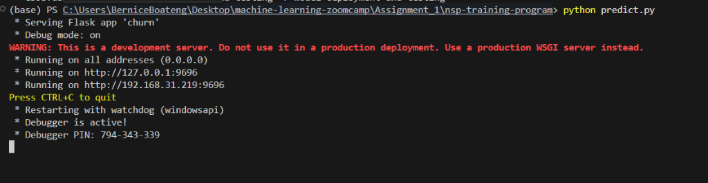
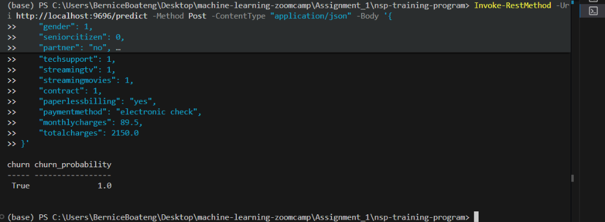
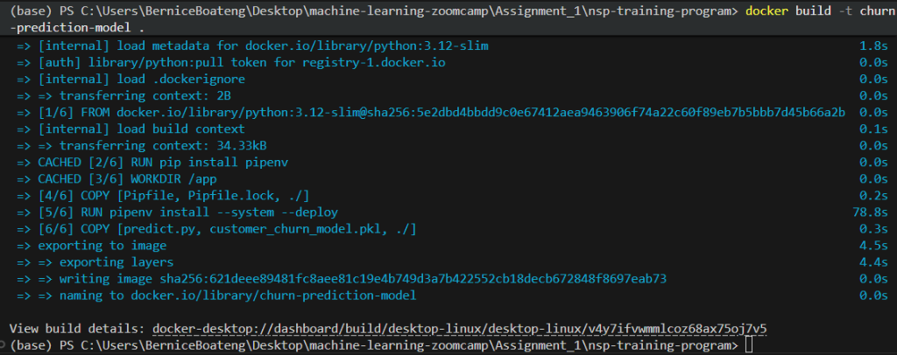
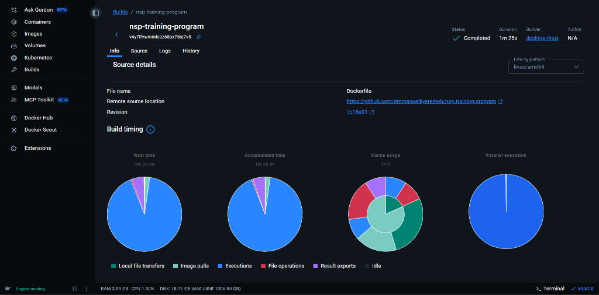
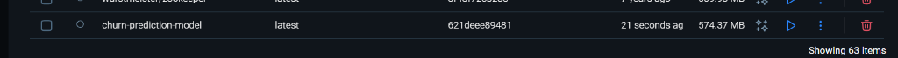
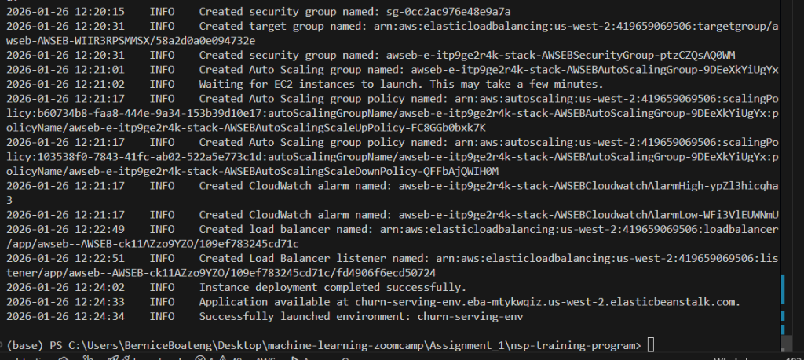
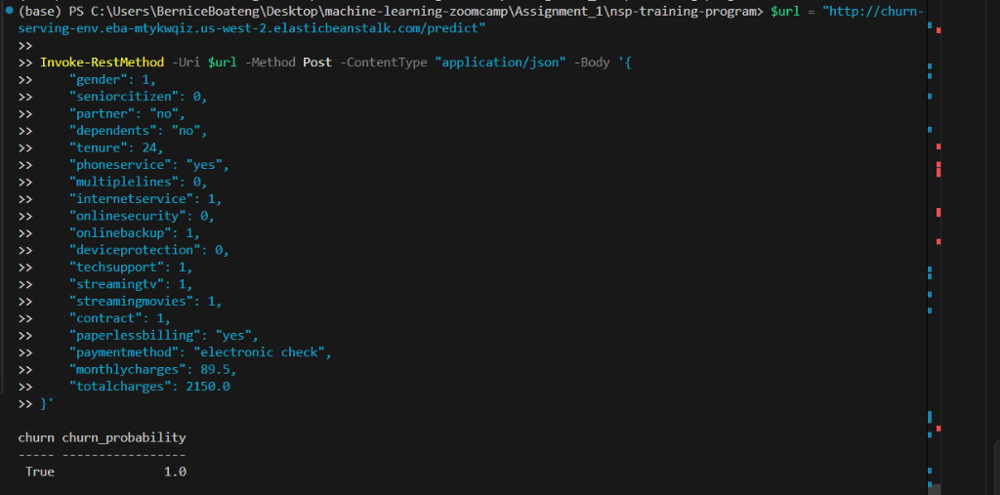
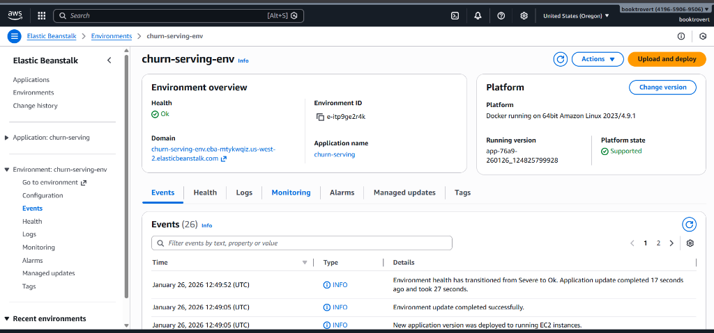
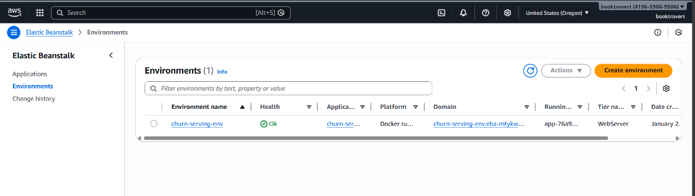

# Predicting Customer Churn 

## 1. What I Did (The Process)
*   **Data Cleaning:** I started by tidying things up. I standardized column names (made them all lowercase and snake_case for sanity) and fixed some annoying missing values in the `TotalCharges` column (turns out blank spaces aren't numbers!).
*   **Exploratory Data Analysis (EDA):** This was the fun part. I went through the columns one by one—literally!—to see what was going on. I visualized everything from `Gender` and `Tenure`to `PaymentMethod`.
    *   *Cool Find:* I realized that people with **Month-to-Month contracts** and **Fiber Optic internet** were way more likely to leave. 
    *   *Another one:* New customers (low tenure) are the most fragile. If they stick around for a year, they are usually loyal for good.
*   **Feature Engineering:** Machines don't understand words like "Yes" or "No", so I converted all the text data into numbers (0s and 1s). I also used **One-Hot Encoding** for things like Payment Method to make sure the model treated them fairly.
*   **Scaling:** Since `Tenure` (0-70 months) and `MonthlyCharges` ($20-$120) had totally different ranges, I scaled them to be between 0 and 1 so the model wouldn't get confused.

## 2. Building the Model 
I chose **Logistic Regression** for this task. Why? Because it's interpretable! It doesn't just say "Churn" or "No Churn"; it gives me a *probability* (e.g., "There's an 80% chance this person leaves"). This is super useful for business decisions.

I split the data: **80% for training** (teaching the model) and **20% for testing** (checking if it actually works).

## 3. The Results
*   **Accuracy:** **82.19%**
    *  Overall, my model guessed correctly 8 out of 10 times. Not bad
    
*   **ROC AUC Score:** **0.8615 (or 86%)**
    *  This is the real star of the show. An AUC of 0.86 is considered **excellent**. It means if you pick a random churner and a random loyal customer, my model has an **86% chance** of correctly ranking the churner higher. It's really good at distinguishing between the two groups.

*   **The Confusion Matrix:**
    *   I correctly identified **222** people who were going to leave (True Positives).
    *   I correctly identified **892** happy customers who stayed (True Negatives).
    *   The model is pretty balanced and doesn't just guess "No Churn" for everyone.

## 4. Key Takeaways
If I were presenting this to the marketing team, here is what I'd say:
1.  **Watch out for Fiber Optic users:** They are paying more, but they are leaving faster. Maybe the service quality isn't matching the price?
2.  **Lock them in:** Month-to-month contracts are dangerous. We should incentivize 1-year or 2-year deals.
3.  **The first few months are critical:** Most churn happens early. We need a better onboarding process for new users.

---

## 5. Model Deployment
After validating the model's performance, I moved towards productionizing it. The goal was to create a scalable service that could accept customer data and return a churn prediction in real-time.

*   **Model Serialization:** I verified the optimal way to save my model. Since I used `pd.get_dummies` for one-hot encoding during training, simply saving the model wasn't enough—I needed to ensure the input data structure for prediction matched the training data exactly. I executed the serialization using `pickle` to save the trained Logistic Regression model as `customer_churn_model.pkl`.

*   **Flask Service Creation:** I developed a web service using **Flask** (`predict.py`). The application loads the saved model and exposes a POST endpoint `/predict`. 
    *   *Robustness Implementation:* A critical challenge was ensuring feature alignment. `pd.get_dummies` dynamically creates columns based on input values. To prevent errors when a single customer record doesn't contain all possible categories (e.g., missing 'PaymentMethod_Mailed check'), I implemented logic to reindex the input DataFrame against the original training columns, filling missing features with 0s. This ensures the model always receives the exact input shape it expects.

*   **Verification:** I started the Flask server and successfully tested it using `Invoke-RestMethod` in PowerShell, simulating a client request.

    *Server Running:*
    

    *Successful Prediction Response:*
    

    The service correctly parsed the JSON input, processed the features, and returned a churn probability of **1.0 (True)** for the high-risk test profile.

---

## 6. Dependency Management & Containerization
To ensure the model runs everywhere, not just on my machine, I isolated the environment.

*   **Pipenv:** I replaced `pip` and `requirements.txt` with **Pipenv**. This gives me a deterministic environment (`Pipfile.lock`), so anyone installing the project gets the *exact* same library versions I used.
*   **Docker:** The final step was wrapping everything in a Docker container.
    *   *The Dockerfile:* I built a lightweight image based on `python:3.12-slim`.
    *   *The Build Process:* I ran into a small issue where my Pipfile wanted Python 3.13 but the base image was 3.12. I fixed this by downgrading the requirement in the Pipfile to match the container.

    *Building the Image:*
    

    *Build Details (Docker Desktop):*
    

    *Container Ready:*
    

    Now the model is a portable, self-contained unit that can be deployed to any cloud provider that supports Docker.

---

## 7. Cloud Deployment (AWS Elastic Beanstalk)
The ultimate test was deploying the container to the public cloud so it could serve real users over the internet.

*   **AWS Setup:** I configured an IAM user with appropriate permissions and set up credentials locally using `aws configure`.
*   **Elastic Beanstalk:** I initialized the deployment with `eb init -p docker` and launched the environment with `eb create`.
*   **Validation:** Once deployed, I received a live URL (`churn-serving-env...`). I verified it by sending a POST request to the live cloud API from my local terminal.

    *Deployment Success (Log):*
    

    *Live Cloud API Verification:*
    


    The cloud API returned the same accurate prediction (Churn Probability: 1.0) as my local Docker container, confirming a successful end-to-end deployment.

*   **Health Check Resolution:** Initially, the environment showed a "Severe" health status because the load balancer's health check was pinging the root path (`/`), which wasn't handled by my Flask app.
    *   *Fix:* I added a simple root route (`/`) to `predict.py` that returns "Churn Prediction Service is Active".
    *   *Result:* After redeploying, the health checks passed, and the environment status turned to **Ok**.

    *Environment Dashboard (Health: Ok):*
    

    *Environment List:*
    

## 8. API Documentation

The deployed model is accessible via a REST API hosted on AWS Elastic Beanstalk.

*   **Live Base URL:** `http://churn-serving-env.eba-mtykwqiz.us-west-2.elasticbeanstalk.com`

### Endpoints

1.  **Health Check**
    *   **URL:** `/`
    *   **Method:** `GET`
    *   **Description:** Returns a simple string to verify the service is running.
    *   **Response:** `Churn Prediction Service is Active`

2.  **Predict Churn**
    *   **URL:** `/predict`
    *   **Method:** `POST`
    *   **Description:** Accepts customer data in JSON format and returns the churn probability.
    *   **Headers:** `Content-Type: application/json`
    *   **Request Body Example:**
        ```json
        {
            "gender": "female",
            "seniorcitizen": 0,
            "partner": "no",
            "dependents": "no",
            "tenure": 12,
            "phoneservice": "no",
            "multiplelines": "no_phone_service",
            "internetservice": "dsl",
            "onlinesecurity": "yes",
            "onlinebackup": "yes",
            "deviceprotection": "yes",
            "techsupport": "yes",
            "streamingtv": "no",
            "streamingmovies": "no",
            "contract": "one_year",
            "paperlessbilling": "yes",
            "paymentmethod": "mailed_check",
            "monthlycharges": 56.85,
            "totalcharges": 1889.50
        }
        ```
        
               {
                "churn" : "True "
                "churn_probability" : "1.0"

               }