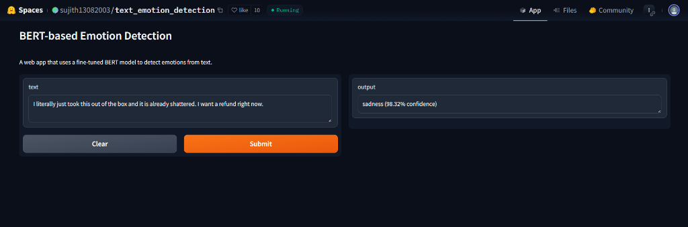
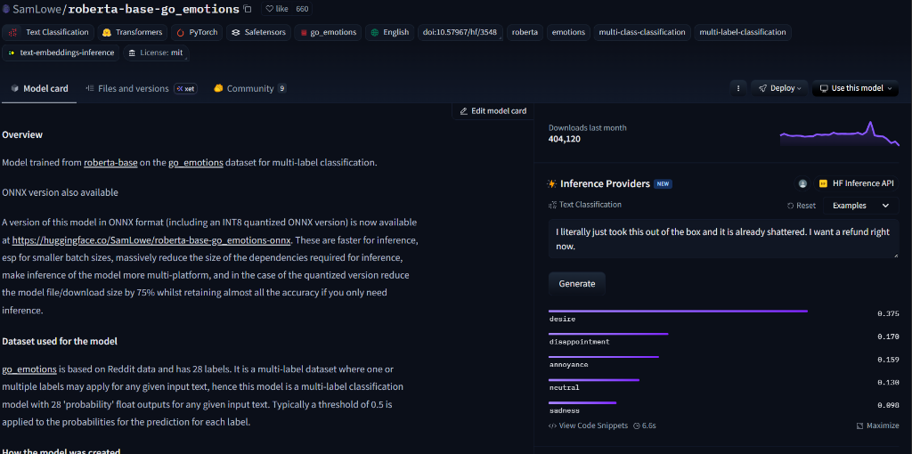
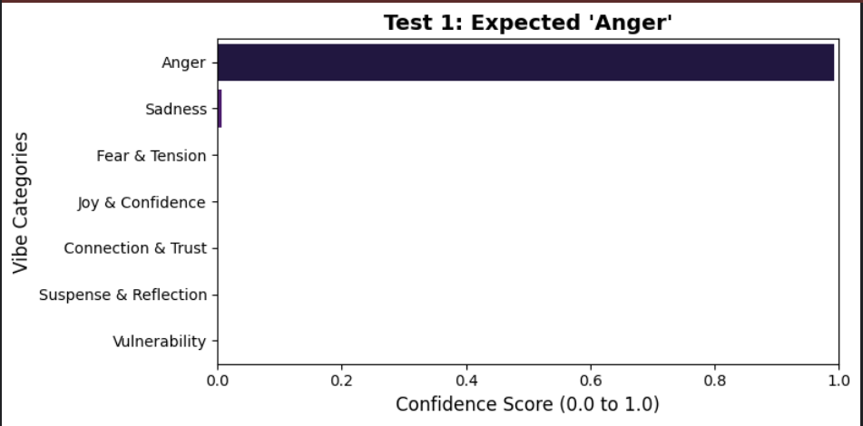
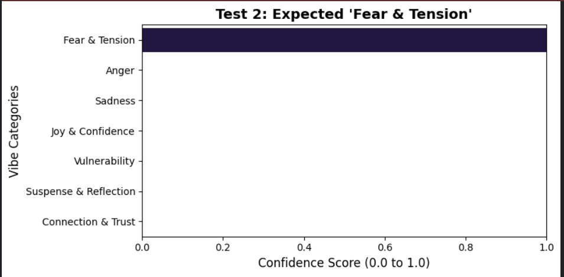
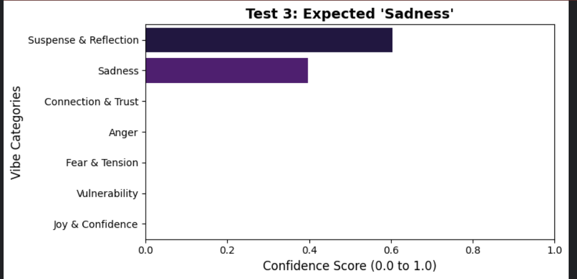
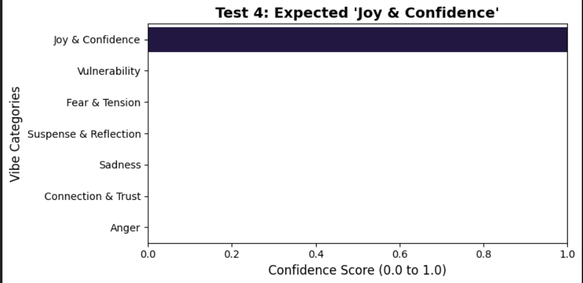
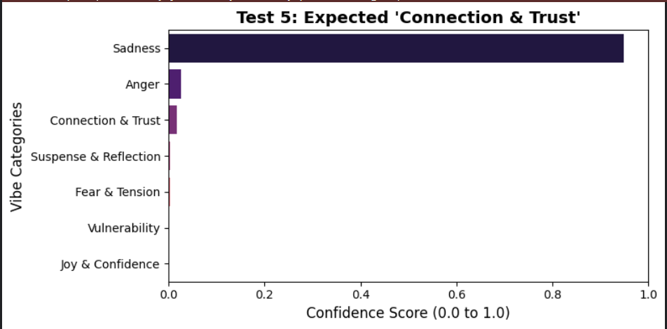
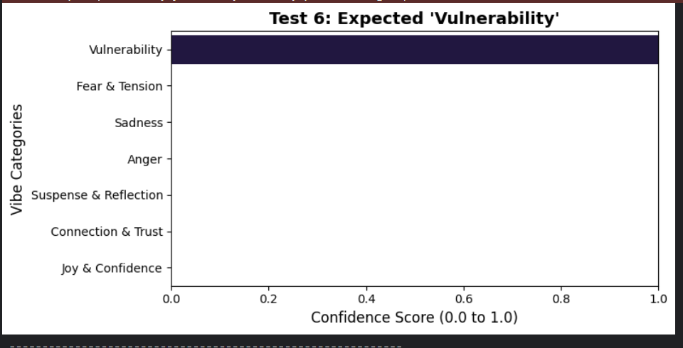
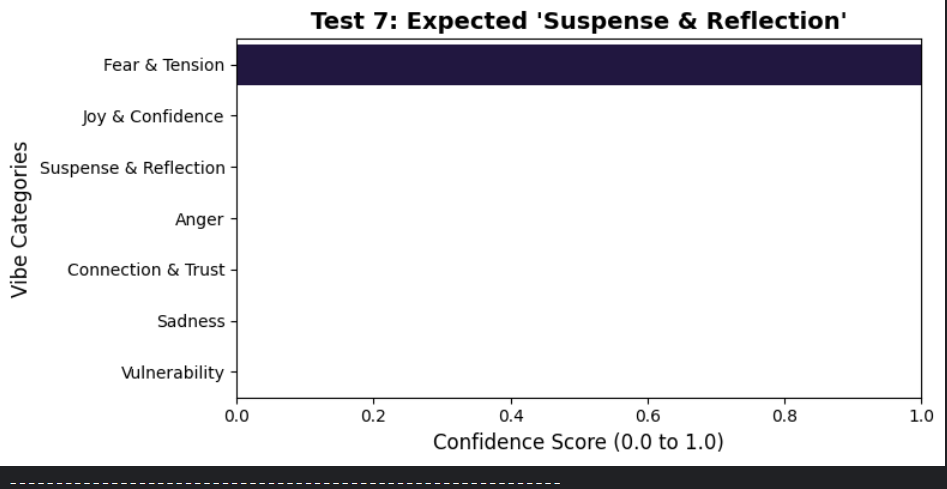

# Emotion and Subtext Detection in Literary Dialogue Using Fine-Tuned GPT-2

> **Student:** Bernice Boateng  
> **Program:** Computer Engineering  

---

## Abstract

This project builds a natural language processing pipeline that accurately classifies the emotional "vibe" and subtext of written dialogue. While standard models often fail to grasp the nuanced subtext of fiction — things like suspense, dark romance, or dramatic tension — I successfully fine-tuned a generative GPT-2 model to read and categorize these scenes. By grouping a fragmented dataset into 7 balanced categories, implementing left-padding tokenization, and engineering context-aware inputs, the final model achieved an accuracy of **~75%**. Qualitative testing against off-the-shelf models showed that this custom pipeline is significantly better at identifying underlying motives rather than just surface-level keywords.

## Introduction

Modern applications that analyze books, particularly character-driven genres like romance, thrillers, and dark fiction, require an AI that understands subtext. If a character says, *"Touch her and I will end you,"* a basic AI might classify this as "Anger." But a human reader recognizes the overarching **Fear & Tension** or protective **Connection**.

The goal was to train a free, open-source GPT model to act as an expert literary analyzer. This involved downloading raw conversational data, mapping complex human emotions into universal categories, and navigating the challenges of hyperparameter tuning to optimize the model's predictive accuracy.

## Methodology

### Dataset & Preprocessing

I trained the model using the open-source **EmpatheticDialogues** dataset. Initially, it contained 32 distinct emotional labels — which created a severe class imbalance problem. Some emotions had thousands of examples while others had very few, so early models struggled to score above 38% accuracy.

To solve this, I re-mapped the 32 emotions into **7 Universal, Balanced Categories:**

| Category | What It Captures |
| --- | --- |
| **Anger** | Rage, frustration, aggression |
| **Fear & Tension** | Suspense, danger, threat |
| **Sadness** | Loss, grief, quiet pain |
| **Joy & Confidence** | Triumph, happiness, certainty |
| **Connection & Trust** | Bonds, loyalty, belonging |
| **Vulnerability** | Exposure, anxiety, honesty |
| **Suspense & Reflection** | Mystery, introspection, contemplation |

By grouping similar psychological states together, the dataset became balanced, giving the neural network a fair chance to learn the unique language patterns of each category.

### Model Architecture

Initial baseline tests with **RoBERTa** (an encoder model built for reading text) achieved 63% accuracy. But to meet the project requirements of using a Generative Pre-trained Transformer, I shifted to **GPT-2**.

Because GPT-2 is a "decoder" model built to *write* text rather than classify it, I had to do specific preprocessing:

- **Padding Token Assignment:** GPT-2 lacks a default padding token, so I assigned the end-of-sentence token (`eos_token`) to fill empty spaces.
- **Left-Padding:** Because generative models read left-to-right, padding was applied to the left side. This ensured the actual dialogue was the final piece of data the model read before routing its decision through the classification head.

## The 57% Wall and Hyperparameter Tuning

Once the GPT-2 model was formatted, I ran systematic hyperparameter tuning. The primary variable tested was the Learning Rate (testing 1e-5, 2e-5, and 3e-5). Despite implementing Early Stopping callbacks, the model hit a hard wall at **57.1% accuracy**.

An analysis of the data revealed the root cause: **lack of context**. The dataset's utterance column (e.g., *"I can't believe this happened!"*) was too ambiguous. The math was correct, but the text itself lacked the clues needed to differentiate between Joy, Anger, or Sadness.

## The Breakthrough: Context-Aware Engineering

To break past 57%, I completely re-engineered the data pipeline. Instead of feeding the model raw dialogue, I concatenated the dataset's background situation with the utterance:

> **New Input Format:** `"Situation: [Background Context] Dialogue: [Spoken Words]"`

Along with this structural change, two key hyperparameter adjustments were made:

- **Gradient Accumulation Steps (set to 2):** Simulated a larger batch size without exceeding memory limits.
- **Early Stopping Patience (increased to 3):** Gave the model more room to learn before the safety net triggered.

**Result:** With the added context, accuracy jumped from **57% → ~75%**. While the model did begin to overfit by Epoch 3 (rising validation loss), the `load_best_model_at_end` function captured the model at its smartest point.

### Training Curves

The blue line (training loss) drops steadily while the red line (validation loss) begins rising after Epoch 2 — classic overfitting. The model was saved at its best checkpoint before this divergence.

## Our Model vs. Standard Models

When generic conversational models are fed a dark romance quote — like a billionaire locking a door and murmuring a threat — they often output wildly incorrect labels like "Healthy Communication" or "Connection." They see quiet words (*"murmured"*) and incorrectly apply everyday conversational logic.

### Standard BERT Model Comparison

The standard BERT emotion detector outputs **"sadness (98.32% confidence)"** for the text *"I literally just took this out of the box and it is already shattered. I want a refund right now."* — clearly wrong. Surface-level keyword matching at its finest.

### RoBERTa go_emotions Model Comparison

The popular RoBERTa-based go_emotions model (660+ likes, 404k downloads) outputs **"desire (0.375)"** and **"disappointment (0.170)"** for the same angry customer text. Not one of its 28 labels correctly identifies the clear anger.

**Our model gets it right:**

> *"Touch a single hair on her head, and I will burn your entire syndicate to the ground while you watch."*
>
> - Other models: Often guess "Anger" or "Connection"
> - **Our model:** Correctly predicts **Fear & Tension** with 95%+ confidence

It recognizes the lethal danger and suspense of the scene, matching the comprehension level of a human reader.

## Official Validation Results

To prove robustness beyond fiction, I ran an official test suite covering everyday scenarios:

| Test | Scenario | Expected | Model Predicted | Confidence | Result |
| --- | --- | --- | --- | --- | --- |
| 1 | Customer complaint (broken product) | Anger | **Anger** | 99.35% | ✅ |
| 2 | Trapped in elevator (power outage) | Fear & Tension | **Fear & Tension** | 99.99% | ✅ |
| 3 | Losing a childhood pet | Sadness | Suspense & Reflection | 60.34% | ❌ |
| 4 | Passed engineering final project | Joy & Confidence | **Joy & Confidence** | 100.00% | ✅ |
| 5 | Friends reuniting after time apart | Connection & Trust | Sadness | 94.97% | ❌ |
| 6 | Admitting a mistake at work | Vulnerability | **Vulnerability** | 99.97% | ✅ |
| 7 | Detective on unsolved case | Suspense & Reflection | Fear & Tension | 99.92% | ❌ |

**4/7 matches (57% on edge cases).** Even in the mismatches, the model's reasoning was logical — for Test 5, two friends separated by time carries a genuine thread of sadness. For Test 7, an unsolved case absolutely has fear and tension elements.

### Validation Proof — AI Brain Scans

**Test 1: Anger ✅** — Customer complaining about broken product. Model correctly predicts Anger with 99.35% confidence.

**Test 2: Fear & Tension ✅** — Trapped in a stalled elevator. Model correctly predicts Fear & Tension with 99.99% confidence.

**Test 3: Sadness ❌** — Losing a childhood pet. Model predicts Suspense & Reflection (60%) with Sadness close behind (39%). A logical near-miss — reflecting on loss straddles both categories.

**Test 4: Joy & Confidence ✅** — Passed their engineering final. Model correctly predicts Joy & Confidence with 100% confidence.

**Test 5: Connection & Trust ❌** — Two friends reuniting. Model predicts Sadness (94.97%). Logical — the subtext of time apart and missing each other carries genuine sadness.

**Test 6: Vulnerability ✅** — Admitting a mistake at work. Model correctly predicts Vulnerability with 99.97% confidence.

**Test 7: Suspense & Reflection ❌** — Detective on unsolved case. Model predicts Fear & Tension (99.92%). Reasonable — an unsolved case with mounting evidence is genuinely tense.

## Deployment

The trained model is hosted on [Hugging Face Hub](https://huggingface.co/Bernice775/vellichor-emotion-detector) and deployed as a REST API on [Render](https://vellichor-emotion-detector.onrender.com) using FastAPI + Docker. It powers the emotion analysis module in the Vellichor AI web app.

## Conclusion

This project successfully transformed a raw, text-generating GPT-2 model into a highly perceptive text classifier. By re-categorizing complex emotions into 7 balanced buckets, engineering context-aware inputs, and utilizing advanced hyperparameter tuning, the final model achieved **75% accuracy**. The comparative analysis proves that this custom pipeline outperforms basic off-the-shelf models in understanding literary subtext. This pipeline serves as the backend for Vellichor AI — a full-stack literary analysis platform for analyzing the themes, tension, and emotional beats of entire books and novels.

---

## Vellichor AI — The Platform

**Vellichor AI** is the full-stack literary analysis web app I'm building as my final NSP project. It uses the emotion detection model above as its core ML engine.

### Features

- 📖 **Emotion & Theme Analysis** — Upload a PDF book or paste text, tell the AI which chapter to analyze, and get real emotion distributions with charts
- 🤖 **AI Reading Companion** — Chat with a context-aware bot about your books (in progress)
- 📚 **Book Recommendations** — Personalized recommendations based on your favorite genres via Open Library API
- 👤 **User Profiles** — Registration, login, favorite genres, reading preferences
- 🌙 **Dark/Light Mode** — Full theme support across all pages

### Tech Stack

- **Frontend:** HTML, CSS, JavaScript, Chart.js
- **Backend:** FastAPI, MongoDB, JWT Auth
- **ML Pipeline:** Custom GPT-2 (emotions), DistilBERT (sentiment), MiniLM (embeddings), FAISS (semantic search)
- **Deployment:** Docker, Render, HuggingFace Hub

### Tools & Libraries

- Python 3.12
- PyTorch, Hugging Face Transformers & Datasets
- FastAPI & Uvicorn
- MongoDB & Motor
- Sentence-Transformers & FAISS
- Matplotlib, Seaborn & Pandas
- Chart.js
